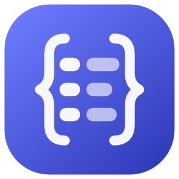

<p align="center">
  
</p>

<h1 align="center">MapPeek</h1>

<p align="center"><b>自动识别 Java 接口里的 <code>Map</code> 入参与出参，生成可直接交付给前端的接口文档。</b></p>

<!-- 下方徽章与插件页链接中的 Marketplace ID 由 project.properties 的 marketplace.id 统一生成，上架后填好重新构建即可 -->
<p align="center">
  
  
  
  
  <a href="https://plugins.jetbrains.com/plugin/36420-mappeek"></a>
</p>

<p align="center">
  <a href="#安装">安装</a> ·
  <a href="#使用">使用</a> ·
  <a href="https://plugins.jetbrains.com/plugin/36420-mappeek">Marketplace</a> ·
  <a href="RELEASE_NOTES.md">发布说明</a> ·
  <a href="README.en.md">English</a>
</p>

Java 项目里 `Map<String, Object>` 类型的接口参数一直是文档工具的盲区：标准工具只能渲染成
`additionalProperties`，前端看到的是一个空对象。MapPeek 直接从源码里把字段捞出来，让你在
IDE 内确认、补注释，再一次导出 OpenAPI 或 JSON Schema。

## 解决什么问题

- `map.put("orderId", ...)` 到底往前端返回了哪些字段，没人说得清
- MyBatis 返回 `Map`，字段名藏在 SQL 别名里，Swagger 显示不出来
- 手工补文档成本高，改一次代码就要同步一次
- 前端反复问「这个接口到底传什么」，后端只能翻代码

MapPeek 把这三件事串起来：**扫描 → 在 IDE 里确认 → 一键导出**。

## 功能

- 识别 `map.put` 字面量、常量 key、`Map.of`，支持嵌套 Map 与 `List<Map>`
- 参数或返回值是实体 / DTO / VO 或 `record` 时自动展开字段，支持嵌套对象、集合与 `Result<T>` 这类泛型包装；`String` 参数经 `parseObject` / `readValue` / `toBean`（含 `TypeReference`）转成 DTO 也能识别，源码外包装如 `R<LoginVo>` 会取实参展开
- 扫描时以项目根作为解析范围，DTO / VO 位于其它模块也能找到（只扫描选中范围内的接口）
- 字段说明取自 `@Schema`、`@ApiModelProperty`、JavaDoc 与行尾注释，字段没有注解时回退到同名 getter 上的注解；`@NotNull`、`@NotBlank`、`@Schema(required / requiredMode)` 标记必填
- 解析 MyBatis 的列别名，覆盖 `@Select` 注解与 XML mapper，支持 `<resultMap>`
- 自动提取接口标题与分组：`@Operation`、`@ApiOperation`、`@Tag`、类与方法 JavaDoc，可用 `--title-annotations` 识别自定义注解
- 识别对象类型的 value，展开其字段与 JavaDoc 注释
- 入参与出参分开推断：出参看方法内构建的 Map，入参看 `get/containsKey` 读取的 key
- 工具窗口内直接编辑字段说明，实时预览，保存即重新生成文档
- 一键复制标准 **JSON Schema**（贴进 Apifox 字段定义）或 **OpenAPI 3.0**（导整份接口文档）
- 支持按项目 / 模块 / 包 / 类 / 单个方法五种粒度扫描

## 环境要求

- IntelliJ IDEA **2023.3 及以上**（见「兼容性」）
- 被扫描项目需为 Java 项目，语言级别支持 8 / 11 / 17 / 21
- 无需编译项目，也不需要启动 Spring 容器；插件只读取源码

## 安装

1. `Settings` → `Plugins`
2. 右上角齿轮 → `Install Plugin from Disk...`
3. 选择 `mappeek-idea.zip`
4. 重启 IDE

从 Marketplace 安装时可跳过以上步骤，直接在 `Plugins` 里搜索 **MapPeek**。插件 ID 为 `mappeek.idea`。

## 使用

在任意层级右键，扫描范围随之变化：

| 触发位置 | 分析范围 |
|---|---|
| `Tools` 菜单（无选中） | 整个项目 |
| 项目树右键模块 / 目录 / 包 | 该模块、目录或包 |
| 项目树右键某个类文件 | 该类的所有接口 |
| 编辑器内右键，或光标停在方法里 | 仅该方法对应的接口 |

无论选哪一级，解析范围都取所在模块的内容根，所以选中单个类时依然能跟到同模块的 service 和
mapper，不会因为范围小而丢字段。

扫描结束后自动打开右侧的 **MapPeek 工具窗口**。

### 工具窗口

**上方：字段表格**

- 入参、出参分成两个页签（中文 IDE 显示「入参 / 出参」，英文 IDE 显示 `Request / Response`），标题带字段数
- 列：`API`、`Title`、`Field`、`Type`、`Conf.`、`Description`（`Dir` 列隐藏，由页签区分）
- 界面文案统一中英双语，中文在前（`接口 / API`、`保存 / Save`）
- `Title`、`Type`、`Description` 列可编辑；类型输入 `Long`、`BigDecimal`、`List<String>` 等会自动归一为 `integer`、`number`、`array`，写入导出的 JSON Schema
- 顶部「目标」下拉可在多次扫描结果之间切换，互不覆盖

**下方：文档预览**

- 随编辑实时刷新，格式为 `{ "key": "字段说明" }`，行尾注释标出类型与是否必填
- `Copy Document`（复制文档）：复制 `mappeek-openapi.json` 全文，范围由扫描目标决定
- `Copy Request`（复制入参）/ `Copy Response`（复制出参）：只复制对应方向的 JSON Schema
- `Save`（保存）：写回说明并立即重新生成 OpenAPI 与 Markdown

两者分工：OpenAPI 是整份接口文档（含 path、method、入参、响应），JSON Schema 只是字段结构，
适合贴进 Apifox 的字段定义区。

复制出的 JSON Schema 形如：

```json
{
  "type": "object",
  "required": ["orderId"],
  "properties": {
    "orderId": {
      "type": "string",
      "description": "订单号"
    },
    "items": {
      "type": "array",
      "items": {
        "type": "object",
        "properties": {
          "skuId": { "type": "integer", "description": "商品编号" }
        }
      }
    }
  }
}
```

`required` 使用数组表示，可直接粘贴到 Apifox 的 JSON Schema 导入。

## 产物位置

```
<项目根目录>/.mappeek/<目标名>/
├── mappeek-api.md           接口字段文档，可直接发前端
├── mappeek-openapi.json     OpenAPI 3.0，可导入 Apifox / YApi / Swagger
├── mappeek-edit.csv         字段说明清单（工具窗口的数据源）
├── mappeek-target.properties 扫描参数（用于「保存」时重新生成）
└── dto/                     带注释的 DTO 骨架（仅选中单个类时生成）
```

目标名规则：选中目录用目录名，选中类用类名（去掉 `.java`），光标在方法里用 `类名-方法名`。

建议把 `.mappeek` 加入 `.gitignore`。

## 工作原理

插件本身是启动器：内置 `mappeek.jar`，用 IDE 自带的 JBR 启动一次静态分析。

- 不编译项目，不启动容器，不连数据库
- 只读取 `.java` 与 MyBatis XML，唯一的写入是项目根目录下的 `.mappeek`
- 同一份分析逻辑同时供命令行与插件使用，两边结果完全一致

字段说明有三个来源，优先级从高到低：`put` 上方或行尾注释、常量字段的 JavaDoc、
SQL `<resultMap>` 的 property。

## 已知限制

- 动态 key（`put(prefix + i, ...)`）无法静态推断，输出为空对象，不做猜测
- 实体 / DTO / VO 必须在扫描范围内的源码中，依赖 jar 或其它模块里的类型不会展开
- 泛型只解析一层实参（如 `Result<OrderVO>`），`T extends` 的复杂约束不做推导
- 跨模块调用链不追踪，只跟随一层，范围外的方法不会展开
- Map 由 `BeanUtil.beanToMap`、`JSON.parseObject`、`convertValue` 等转换生成时，静态分析看不到
- 类型为尽力推断，推断失败的字段标 `low`，统一降级为 `string`，导入后建议人工确认
- 中文注释依赖源码本身有注释；数据库列注释无法获取

## 常见问题

**扫描后字段是空的？**
确认接口的 Map 是通过 `put`、`Map.of` 或 MyBatis 别名产生的。若来自第三方转换工具，属于已知限制。

**为什么扫描单个类也能识别到 service 里的字段？**
解析范围取模块内容根，而不是你选中的那个类，这样才不会丢字段。

**改了说明但文档没变？**
需要点「保存」触发重新生成；`复制 OpenAPI` 读的是磁盘上的文件，未保存时复制到的是旧内容。

**会修改业务代码吗？**
不会。唯一写入是项目根目录的 `.mappeek`。

## 开发与构建

前置：`../mappeek-core/target/mappeek.jar` 已存在（在 `mappeek-core` 目录执行 `mvn -DskipTests package`）。

```powershell
.\build.ps1

# IDE 或 JDK 路径不同时
.\build.ps1 -IdeaHome "D:\JetBrains\IntelliJ IDEA 2026.1.3" -JdkHome "D:\Java\jdk-21.0.11"
```

脚本做三件事：对着 IDEA 自带 jar 编译、把 `plugin.xml` 与 class 打成 `mappeek-idea.jar`、
连同 `mappeek.jar` 一起压缩成可安装的 zip。

### 目录结构

```
mappeek-idea/
├── build.ps1
├── src/main/java/mappeek/idea/
│   ├── ScanAction.java              扫描入口，构造命令行并执行
│   ├── FieldsPanel.java             工具窗口：表格、预览、复制
│   ├── FieldsToolWindowFactory.java 工具窗口注册
│   ├── EditFieldsAction.java        重新打开上次结果
│   └── FieldCsv.java                mappeek-edit.csv 读写
├── src/main/resources/META-INF/plugin.xml
└── dist/mappeek-idea.zip            安装包
```

## 兼容性

支持 IntelliJ IDEA 2023.3（build 233）及以上。插件与内置分析器均编译为 Java 17 字节码，
与 2023.3 起自带的 JBR 17 一致。

已验证：

- 编译使用 `--release 17`，未引用高于 Java 17 的 JDK API
- 两个 jar 的 class 文件版本均为 61（Java 17），可在 JBR 17 上加载
- 内置分析器在 Java 17 运行时实跑通过，包含默认导出与 `--overrides` 说明回填
- 用到的 IntelliJ API（`ToolWindowManager`、`ContentFactory`、`NotificationGroupManager`、
  `Task.Backgroundable` 等）在 233 均已提供

尚未在真实的 2023.3 IDE 中做人工回归。上架前建议用
[JetBrains Plugin Verifier](https://plugins.jetbrains.com/docs/intellij/verifying-plugin-compatibility.html)
对 IC-233 跑一次，能扫出遗漏的 API 兼容问题。

## 作者

<!-- author:begin -->
**疯狂de程序员**　邮箱：yangsf_app@163.com
<!-- author:end -->

## 许可证

MIT，全文见 [LICENSE](LICENSE)。
